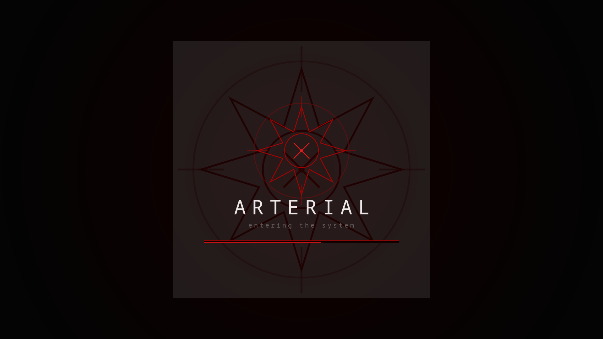

# Arterial — Plymouth Boot Splash

A black / dark-grey / arterial-red boot splash that matches the
[Arterial KDE suite](https://github.com/numbpill3d/arterial-kde). A pulsing, slowly
rotating eight-point sigil over a red vignette, an `ARTERIAL` wordmark, and a thin red
progress bar. Handles the encrypted-disk passphrase prompt (lock + bullets) and status
messages.

> The image above is composited from the theme's own PNG assets at ~60% progress — a
> faithful preview of the boot frame. (Capturing the live splash needs a root DRM takeover
> of the screen.)

It's a **script**-module theme, and all text is pre-baked to PNG, so it never depends on
runtime fonts inside the initramfs.

## Requirements

Plymouth with the `script` module, `splash` on the kernel command line, and the `plymouth`
hook in your initramfs (`mkinitcpio` or `dracut`).

## Install

    git clone https://github.com/numbpill3d/arterial-plymouth
    cd arterial-plymouth
    ./build-assets.sh      # (re)render the PNGs — optional, they're committed
    ./install.sh           # copies to /usr/share/plymouth/themes/arterial and sets it default (-R rebuilds initramfs)

Manual:

    sudo cp -r . /usr/share/plymouth/themes/arterial
    sudo plymouth-set-default-theme -R arterial

For `mkinitcpio` (Arch/EndeavourOS) make sure `HOOKS` contains `plymouth` (after `base
udev`), and the kernel line has `splash quiet`.

## Test the animation (no reboot)

    sudo plymouthd --debug --no-daemon &
    sudo plymouth show-splash
    sudo plymouth update --status=test ; sleep 3 ; sudo plymouth quit

## Files

- `arterial.plymouth` — theme manifest (script module)
- `arterial.script` — the splash program (background, sigil pulse/spin, progress, password prompt, messages)
- `*.png` — baked assets · `build-assets.sh` regenerates them · `_svg/` holds the sigil source

By splicer scorn (voidrane). GPL-3.0-or-later.
